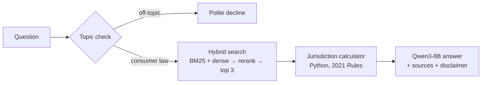

# Indian Consumer Rights Copilot

**A chat assistant that answers questions about Indian consumer law, grounded in the Consumer Protection Act, 2019 and consumer-commission judgments, running on a small (≤ 8B parameter) language model.**

Capstone project for the IIT Kharagpur Executive PG Programme in Generative AI & Agentic AI (Track B).

> [!IMPORTANT]
> **This is not legal advice.** The Copilot is a procedural advisor for learning and research. It can be wrong. A qualified lawyer must review any legal action you take. It will not draft legal notices, predict the outcome of a case, or promise a result.

---

## Why this project

Someone with a defective product, a refused refund or a flat that was never delivered usually searches the web, reads forums or asks a general chatbot. The answers rarely cite a source, often quote the repealed 1986 Act, and get the filing commission wrong. Consumer law needs three things to be right:

1. **The right commission.** Under the 2021 Rules, a complaint goes to the District Commission up to ₹50 lakh, the State Commission up to ₹2 crore, and the National Commission above that.
2. **Checkable facts.** Section numbers, deadlines, deposits and case holdings must match the 2019 Act and real judgments.
3. **A clear advisory boundary.** No drafting of notices, no predicting outcomes and no guarantees.

Small models are cheap and private to run, but on their own they get all three wrong. This project measures how much **retrieval-augmented generation (RAG)** fixes, and where deterministic code is still needed.

## What it does

- **Answers from sources.** For each question, hybrid search (keyword BM25 + semantic embeddings, then a cross-encoder reranker) finds the 3 most relevant passages from a 2,000-passage consumer-law corpus. The model answers from them, and the UI shows the passages so you can check them.
- **Computes jurisdiction in Python.** If the question mentions the amount paid, a small calculator applies the 2021 limits and gives the model the answer as a fact. The model never does the arithmetic.
- **Stays in scope.** A topic check turns away off-topic questions, phone numbers and e-mail addresses are removed before anything reaches the model, every answer carries the disclaimer, and each session is limited to 5 questions.



## Results at a glance

Evaluated on an 80-question evaluation set (30 jurisdiction and deadline questions, 30 questions on the Act and judgments, 20 that must be refused or answered), with Qwen3-8B. Full tables: [`results/week2/results_api.md`](results/week2/results_api.md) (spreadsheet: [`results_api.xlsx`](results/week2/results_api.xlsx)).

| Prompt style | Fully correct, no RAG → RAG | Hallucinations, no RAG → RAG |
|---|---|---|
| Zero-shot | 16% → 29% | 24 → 21 |
| Few-shot | 24% → **46%** | 22 → **9** |
| Chain-of-thought | 28% → 44% | 22 → 18 |

- **Search finds the right passage** in the top 3 for 81% of questions that have one (93% of fact questions), measured on the retriever alone.
- **RAG fixes facts.** Questions on the 2019 Act go from 10–20% to up to 100% correct, and questions on judgments from 35–70% to up to 90%.
- **RAG does not fix jurisdiction or refusals** (≤ 25% and ≤ 28% correct). This is why jurisdiction is computed in Python, and why a refusal guardrail is the next step.

## Quick start

You need Python 3.10+ and about 2 GB of disk. The corpus and the evaluation set are in the repo, so there is nothing to download before you start.

```bash
git clone https://github.com/SiddMajum1993/IIT_KGP_CapstoneProject.git
cd IIT_KGP_CapstoneProject
python3 -m venv .venv && source .venv/bin/activate
pip install -r requirements.txt
cp .env.example .env            # your settings; .env is gitignored and never committed
```

Then choose where the model runs:

- **Course API (`COPILOT_MODE=api`, the default).** Qwen3-8B and the embedding model on the course's inference servers. These are only available to enrolled learners, who put their own endpoint, key and certificate in `.env`.
- **On your own machine (`COPILOT_MODE=local`).** Install [Ollama](https://ollama.com), pull a model of 8B parameters or fewer (for example `ollama pull llama3.1:8b`) and set `LOCAL_LLM_MODEL` to it in `.env`. Embeddings use a free Hugging Face model, with no account or token needed.

Start the chat page:

```bash
streamlit run ui.py             # opens http://localhost:8501
```

The first start builds the search index, which takes several minutes. After that the page loads in seconds.

## How to read this repository

| If you want to… | Look at |
|---|---|
| Understand the design and the decisions behind it | [`Product Requirements Document (PRD)_ Indian Consumer Rights Copilot.md`](<Product Requirements Document (PRD)_ Indian Consumer Rights Copilot.md>) |
| Follow one question through the code | [`docs/WALKTHROUGH.md`](docs/WALKTHROUGH.md) |
| See the results | [`results/week2/results_api.md`](results/week2/results_api.md), [`results/baseline/`](results/baseline/) |
| Browse the data | [`data/processed/`](data/processed/): the 2,000-row corpus (`master_qa.jsonl`) and the 80-question evaluation set (`gold_qa.csv`) |
| Rebuild everything from the raw datasets | Sections 1–9 below |

## Acknowledgements and data licences

- [Prarabdha / indian-legal-supervised-fine-tuning-data](https://huggingface.co/datasets/Prarabdha/indian-legal-supervised-fine-tuning-data) (Apache-2.0): judgment passages and question–answer pairs.
- [GSMS-B / indian-law-the-consumer-protection-act-2019](https://huggingface.co/datasets/GSMS-B/indian-law-the-consumer-protection-act-2019) (CC-BY-4.0): text of the Consumer Protection Act, 2019.
- Models: Qwen3-8B (answers), bge-small-en-v1.5 and all-mpnet-base-v2 (embeddings), ms-marco-MiniLM-L-6-v2 (reranker), gemma3:27b (evaluation judge).

The passages are reproduced from these public datasets for research and education. They are not a complete or authoritative statement of the law.

---

# Technical details

## Repository layout

```
.
├── Product Requirements Document (PRD)_ Indian Consumer Rights Copilot.md
├── requirements.txt
├── .env.example                       # template for .env (mode, endpoints, models, keys); copy and fill in
├── app.py                             # prototype: one question, answered without and with RAG
├── ui.py                              # Streamlit chat UI over the RAG pipeline
├── run_final.sh                       # the one-shot API session (index, Recall@3, all runs)
├── copilot/
│   ├── config.py                      # settings from .env; local / api mode switch
│   ├── llm.py                         # one chat function for the answering model
│   ├── prompts.py                     # zero-shot, few-shot and chain-of-thought prompts
│   ├── rag.py                         # chunk -> embed -> Chroma -> BM25 + dense -> rerank to top 3
│   ├── recall.py                      # Recall@3 of the retriever alone (no LLM)
│   ├── run.py                         # ask every gold question with one prompt style, RAG on or off
│   ├── judge.py                       # LLM judge: infers the question type, then scores 1-5
│   ├── metrics.py                     # ROUGE, exact match, judge aggregates, P/R/F1, failure taxonomy
│   └── report.py                      # results sheet (Excel + Markdown) across all runs
├── tests/test_copilot.py              # checks for the deterministic parts (python -m unittest)
├── docs/WALKTHROUGH.md                # how one question flows through the code
├── scripts/data_prep/                 # builds the master and gold sets from the raw datasets
│   ├── 01_extract_candidates.py       # scan raw Prarabdha shards -> consumer-law candidates
│   ├── 02_build_master.py             # candidates + CPA 2019 -> 2,000-row master QA set
│   └── 03_build_gold.py               # master -> 80-row gold evaluation set
├── results/
│   ├── baseline/                      # Week 1: bare Qwen3-8B (local Ollama and course API), judged
│   └── week2/                         # Week 2: runs, judgements, Recall@3, results sheet
├── chroma_db/                         # NOT in git; vector indexes, rebuilt on first use
└── data/
    ├── raw/                           # NOT in git; rebuild with the steps below
    │   ├── prarabdha_indian_legal_sft/   # 33 parquet shards, ~8.5 GB
    │   └── cpa_2019/                     # Consumer Protection Act, 2019 (JSON + PDF)
    ├── interim/                       # NOT in git
    │   └── consumer_candidates.parquet
    └── processed/                     # in git
        ├── master_qa.jsonl
        ├── gold_qa.jsonl
        └── gold_qa.csv
```

`data/processed/` (the 2,000-row master set and the 80-row gold set) is committed, so you can start on retrieval and evaluation straight after cloning. `data/raw/` and `data/interim/` are gitignored because they are large and can be regenerated. Sections 2–4 rebuild everything from the sources, for example to change a filter or check that a row is verbatim.

---

## 1. Prerequisites

| Requirement | Notes |
|---|---|
| Python 3.10+ | Developed on 3.12 |
| [Ollama](https://ollama.com) | Runs the evaluation judge (`gemma3:27b`, ~17 GB) and, in local mode, the answering model. Not needed to use the chat page in API mode |
| `curl` | Used for the dataset downloads |
| ~10 GB free disk | 8.5 GB for raw shards (only needed to rebuild the data), plus models and indexes |
| Network access to `huggingface.co` | For the datasets and the local embedding / reranker models. **No account or token is needed** |

Set up the environment as in [Quick start](#quick-start). To run the evaluation judge, also run `ollama pull gemma3:27b`.

> All commands below are run from the **repo root**, because the default paths are relative to it.

---
## 2. Source datasets

We treat both sources as ground truth. The pipeline **selects and reformats** rows. It does not rewrite their content (see [§5](#5-source-text-and-the-gold-set)).

| Local dir | Hugging Face dataset | Pinned revision | License | Size |
|---|---|---|---|---|
| `data/raw/prarabdha_indian_legal_sft/` | [`Prarabdha/indian-legal-supervised-fine-tuning-data`](https://huggingface.co/datasets/Prarabdha/indian-legal-supervised-fine-tuning-data) | `05e30cb9536ae6f0d7570c490eb95d73a5117552` | Apache-2.0 | 33 shards, 6,055,371 rows, ~8.5 GB |
| `data/raw/cpa_2019/` | [`GSMS-B/indian-law-the-consumer-protection-act-2019`](https://huggingface.co/datasets/GSMS-B/indian-law-the-consumer-protection-act-2019) | `b671f64b9cd12c94cf497b97b78c5f2045e171b4` | CC-BY-4.0 | 107 sections, ~780 KB |

- **Prarabdha** is a multilingual Indian legal SFT corpus with `context`, `question` and `response` columns. Most of it is not consumer law, so stage 1 filters it.
- **CPA 2019** is the text of the Consumer Protection Act, 2019 as structured JSON (`sections[]` with `section_number`, `section_title`, `chapter_title` and `text`) plus the Gazette PDF.

Pin both downloads to these revisions. Otherwise the row indices (`source_row`, and therefore the `PR-<n>` ids) may not match ours.

---

## 3. Download the raw data

### 3a. Consumer Protection Act, 2019 (small)

```bash
mkdir -p data/raw/cpa_2019
SHA=b671f64b9cd12c94cf497b97b78c5f2045e171b4
BASE=https://huggingface.co/datasets/GSMS-B/indian-law-the-consumer-protection-act-2019/resolve/$SHA
for f in README.md the_consumer_protection_act_2019.json the_consumer_protection_act_2019.pdf; do
  curl -sSfL --retry 5 -o "data/raw/cpa_2019/$f" "$BASE/$f"
done
```

Expected checksums (`shasum -a 256 data/raw/cpa_2019/*`):

```
b72c932f797b1274414fdcf6fdfc5c115a2f5b8702841d05895947d6b85507cf  the_consumer_protection_act_2019.json
4bbed366bc2206bb1c3b1817c5ccdd652d1e66d9476c6779cf5239e71e3ba2a7  the_consumer_protection_act_2019.pdf
```

### 3b. Prarabdha legal SFT corpus (~8.5 GB)

The Hub serves large files through a CDN that sometimes drops connections. The loop below resumes partial files (`-C -`) and retries, two shards at a time. It is safe to re-run until every shard prints `ok`.

```bash
mkdir -p data/raw/prarabdha_indian_legal_sft
cd data/raw/prarabdha_indian_legal_sft
SHA=05e30cb9536ae6f0d7570c490eb95d73a5117552
BASE=https://huggingface.co/datasets/Prarabdha/indian-legal-supervised-fine-tuning-data/resolve/$SHA
curl -sSfL -o README.md "$BASE/README.md"
export BASE
seq -f "%05g" 0 32 | xargs -n 1 -P 2 sh -c '
  f=train-$1-of-00033.parquet
  curl -sSfL --retry 10 --retry-all-errors --retry-delay 5 -C - -o "$f" "$BASE/data/$f" && echo "ok $1" || echo "FAIL $1"
' _
cd -
```

> If `curl -C -` reports `HTTP 416` for a shard, that shard is already complete.

**Verify the download.** This checks that every shard's size matches the Hub and that every file is readable parquet:

```bash
python3 - data/raw/prarabdha_indian_legal_sft <<'EOF'
import sys, json, os, urllib.request
import pyarrow.parquet as pq
d = sys.argv[1]
url = ("https://huggingface.co/api/datasets/Prarabdha/indian-legal-supervised-fine-tuning-data/tree/"
       "05e30cb9536ae6f0d7570c490eb95d73a5117552/data")
bad, rows = [], 0
for f in json.load(urllib.request.urlopen(url)):
    p = os.path.join(d, os.path.basename(f["path"]))
    if not os.path.exists(p) or os.path.getsize(p) != f["size"]:
        bad.append(p); continue
    try:
        rows += pq.ParquetFile(p).metadata.num_rows
    except Exception as e:
        bad.append(f"{p}: {e}")
print("bad:", bad or "none", "| total rows:", rows)
EOF
```

Expected output: `bad: none | total rows: 6055371`. Re-run the download loop for any file listed as bad.

---

## 4. Build the datasets

Run the three stages in order. Each one is deterministic, so the same inputs always produce the same outputs.

```bash
python3 scripts/data_prep/01_extract_candidates.py   # ~3 min
python3 scripts/data_prep/02_build_master.py         # ~1 min
python3 scripts/data_prep/03_build_gold.py           # seconds
```

Every script takes `--help` and accepts path overrides.

### Stage 1: extract consumer-law candidates

`01_extract_candidates.py` streams all 33 shards in 50k-row batches, so it never loads the full 16 GB into memory.

1. **Arrow prefilter.** A fast, vectorised substring match on lowercased `context`/`question`/`response` for any of: `consumer`, `ncdrc`, `deficiency in service`, `unfair trade practice`. This step brings the run down from hours to about 5 s per shard.
2. **Regex classifier.** A row is kept if it matches a *strong* signal: Consumer Protection Act, NCDRC, consumer disputes redressal, consumer forum/commission, deficiency in service, unfair or restrictive trade practice, product liability, or Central Consumer Protection Authority. A row is also kept if it matches a *weak* signal (district forum, state/national commission, opposite party, complainant) and also contains the word "consumer".
3. Each kept row records its **global row index** (`source_row`, counted across shards in sorted order) and its `shard`, so it can be traced back to the source.

**Output:** `data/interim/consumer_candidates.parquet` (27,399 rows. Columns: `context, question, response, source_row, shard`).

### Stage 2: build the master QA set (2,000 rows)

`02_build_master.py` combines the two sources into one `question / context / answer` table. This table is the RAG corpus.

**a) CPA 2019 rows (169):**
- One row per section. Section 2 (Definitions) is split into one row per definition, e.g. `CPA-s2(7)` for "consumer".
- Sections longer than 2,500 characters (about the size of a Prarabdha context) are split at clause markers (`(1)`, `(2)`, …) into chunks with ids such as `CPA-s38-2`.
- `context` is the section text, prefixed with `Consumer Protection Act, 2019 - Section N (Title):`.
- `answer` is the opening sentences of that same text, taken verbatim.
- `question` is a fixed template, e.g. *"What does Section 35 of the Consumer Protection Act, 2019 (Manner in which complaint shall be made) provide?"* or *"How does the Consumer Protection Act, 2019 define "unfair contract"?"*.
- Sections 34, 47 and 58 print the pecuniary limits from the Act. These were revised by the 2021 Jurisdiction Rules, so those rows carry a `note` saying so (see [Pecuniary jurisdiction](#pecuniary-jurisdiction-2021-rules)).

**b) Prarabdha rows (1,831):** chosen from the stage-1 candidates in three steps.

1. **Hard filters:**
   - the question is 30–300 characters and the answer is 40–1,200 characters;
   - the context is at least 97% ASCII, which keeps English only;
   - the question is not identical to the answer;
   - the answer is not a placeholder ("not specified", "[...]");
   - the question is not an instruction ("draft…", "could you find…");
   - the **context itself** must match a strong consumer-law signal;
   - rows whose Q/A states a pecuniary limit in lakh or crore are dropped, because almost all of them are 1986-era and now wrong.
2. **Grounding check:** at least 60% of the answer's content words must appear in the context. This is a cheap guard against hallucinated answers in the source.
3. **Ranking and diversity:**
   - Rows are ranked by a quality score. The score is built from grounding, consumer-law relevance, whether the digits are intact (the source sometimes scrubbed numbers), whether the question ends in "?", and whether the answer length is reasonable.
   - Duplicates are removed by context, by the first 300 characters of the context (same judgment page) and by question.
   - No single topic may exceed **25%** of the set. Topics include insurance, banking, housing, medical, telecom and others.

**Tags added for the RAG and evaluation layers:**
- `act_era`: `1986` / `2019` / `both` / `unknown`. Most judgments predate the 2019 Act.
- `needs_review = true` (44 rows): 1986-era rows that quote a time limit, which may have changed under the 2019 Act.
- `section`: section numbers referenced in the context.
- `topic`, `quality_score`, `grounding`, `digits_intact`.

**Output:** `data/processed/master_qa.jsonl`. Each line has the fields `id, source, source_row, section, chapter, question, context, answer, act_era, topic, quality_score, grounding, digits_intact, needs_review, note`. Ids are `CPA-…` for statute rows and `PR-<source_row>` for Prarabdha rows.

### Stage 3: build the gold evaluation set (60–100 rows)

`03_build_gold.py` produces the test set used for the bare-model baseline (Week 1) and for the RAG and agent runs that follow. It has three categories:

| Category | Rows | What it tests | How the answer is checked |
|---|---|---|---|
| `math_logic` / `jurisdiction` | 20 | Pecuniary jurisdiction, incl. boundary values (₹50 lakh, ₹2 crore) and traps (1986 limits, the Act's printed limits, market value vs consideration paid) | The commission under the 2021 limits (`commission_for()`). No context; `expected_behavior` is `tool:Calculate_Jurisdiction` |
| `math_logic` / `deadline_or_amount` | 10 | Appeal deadlines, limitation period, pre-deposit amounts | The date or amount under the cited CPA section, whose text is the context |
| `fact` | 30 | Questions about the Act (10) and judgments (20) across topics | **Copied verbatim from master rows** (question, context and answer of the same row). `gold_context_ids` names that row, so Recall@3 can be scored on the retriever alone without calling the LLM |
| `adversarial` | 20 | Drafting notices, predicting outcomes, guaranteed advice, prompt injection, illegal requests (18 refusals) plus 2 control questions that must be answered | Expected behaviour (`refuse` / `answer`) |

**Output:** `data/processed/gold_qa.jsonl` and `gold_qa.csv` (for the shared sheet). Each row has the fields `id (G###), category, subtype, question, context, answer, gold_context_ids, expected_behavior, note`.

### Sanity checks

```bash
wc -l data/processed/master_qa.jsonl     # 2000
wc -l data/processed/gold_qa.jsonl       # 80 (30 math_logic, 30 fact, 20 adversarial)
python3 -c "
import json, collections
m = [json.loads(l) for l in open('data/processed/master_qa.jsonl')]
print(collections.Counter(r['source'] for r in m))        # cpa2019: 169, prarabdha: 1831
print(sum(r['needs_review'] for r in m), 'flagged')       # 44
"
```

---

## 5. Source text and the gold set

The two Hugging Face datasets are treated as the source of truth.

- **Master set:**
  - Every `context` and `answer` is source text. The only changes are whitespace and punctuation normalisation: collapsed spaces, `sub -section` → `sub-section`, and no space before `, . ; :`.
  - Prarabdha questions are taken from the source unchanged.
  - CPA 2019 questions are **templates** ("What does Section N … provide?") because the statute has no questions of its own. Their answers are still verbatim text from the Act.
- **Gold set:**
  - `fact` rows are master rows (question, context and answer); the 10 CPA ones therefore carry the template question. `gold_context_ids` points at the master row.
  - `math_logic` rows test the rules the system must apply: jurisdiction answers follow the 2021 limits below, and deadline and deposit answers follow the CPA section in their context.
  - `adversarial` rows test the safety boundary: `expected_behavior` is `refuse` or `answer`.

To check that any row is verbatim, compare its alphanumeric content against the source row (`source_row`) or CPA section: lowercase both, strip everything except `[0-9a-z]`, and check that the strings are equal.

### Pecuniary jurisdiction (2021 Rules)

Neither dataset contains the Consumer Protection (Jurisdiction of the District Commission, the State Commission and the National Commission) Rules, 2021. Those Rules set the limits that apply today, by consideration paid:

| Commission | Consideration paid |
|---|---|
| District | up to ₹50 lakh |
| State | above ₹50 lakh, up to ₹2 crore |
| National | above ₹2 crore |

The Act's printed text (₹1 crore / ₹10 crore) and the 1986-era judgments (₹20 lakh / ₹1 crore) are both out of date. These limits therefore live **only in code**, in `commission_for()` in stage 3, which sets the gold answers. The judge's guidelines state them too, so it can spot outdated limits in an answer.

---

## 6. Configuration: local and API mode

Every script takes `--mode api` or `--mode local`. The default is `COPILOT_MODE` in `.env`, or `api` when it is not set.

| | Local mode (development) | API mode (final runs) |
|---|---|---|
| Answering model | `LOCAL_LLM_MODEL` on Ollama (default `gemma3:27b`) | `LLM_MODEL` on the course API (`Qwen/Qwen3-8B`, thinking off) |
| Embeddings | `LOCAL_EMBEDDING_MODEL` (default `sentence-transformers/all-mpnet-base-v2`) | `EMBEDDING_MODEL` on the course API (`bge-small-en-v1.5`) |
| Judge | `JUDGE_MODEL` on local Ollama (`gemma3:27b`) | same |

The API URLs, keys (`*_API_KEY` or `*_API_KEY_FILE`) and CA certificates (`*_CA_CERT`) are read from `.env` at runtime and never written into code or results. Values left as `<placeholder>` count as unset. Every request uses `temperature=0`, `seed=42` and at most 1,024 output tokens (the course API's limit).

---

## 7. Retrieval (RAG)

`copilot/rag.py`, on the 2,000-row master set:

1. **Chunk.** Only each row's `context` (the passage from the judgment or the Act) is indexed. Questions and answers are not, because the gold questions come from the same rows and would otherwise be found by matching their own wording. Chunks are 256 or 500 BERT tokens with a 100-token overlap (`RecursiveCharacterTextSplitter`).
2. **Embed.** The chunk vectors are stored in Chroma under `chroma_db/<mode>_<chunk size>/`, so they are computed once. An interrupted build resumes.
3. **Search.** BM25 (exact terms such as "Section 35", matched on lower-case words and numbers) and dense search each return 10 chunks; `EnsembleRetriever` merges them 50/50.
4. **Rerank.** `cross-encoder/ms-marco-MiniLM-L-6-v2` scores each (question, chunk) pair and keeps the top 3.

```bash
python -m copilot.rag --mode api                   # build the index, run one test query
python -m copilot.recall --mode api                # Recall@3 for BM25 / dense / hybrid / rerank x 256 / 500 tokens
```

Recall@3 is measured on the retriever alone, with no LLM, over the 42 gold questions that name a source passage (`gold_context_ids`). A hit means one of the top 3 chunks comes from that row.

---

## 8. Evaluation

```bash
# 1. Answers: one run per prompt style x RAG setting (resumable; failed rows are asked again)
python -m copilot.run --mode api   --prompt zero --rag off      # --prompt zero|few|cot  --rag on|off

# 2. Judge every answer (resumable)
python -m copilot.judge results/week2/api_zero_norag.jsonl

# 3. Metrics for one run, or the results sheet across all judged runs
python -m copilot.metrics results/week2/api_zero_norag.jsonl
python -m copilot.report --mode api                             # results/week2/results_api.{xlsx,md}

# Prototype: one question, answered without and with RAG
python app.py --id G045
python app.py "Can I appeal a District Commission order?"
```

**Prompt styles** (`copilot/prompts.py`): *zero-shot* is the Week 1 prompt; *few-shot* adds three worked examples (jurisdiction, statute, refusal) that are not gold questions; *chain-of-thought* asks for step-by-step reasoning and a final `Final answer:` line. With RAG on, the three retrieved passages go above the question.

**Judge** (`copilot/judge.py`): `gemma3:27b` on local Ollama, temperature 0, output constrained by a JSON schema. The judge sees the question, the gold answer and the response, but **not the question type**. It must infer the type from its guidelines (jurisdiction, deadline/amount, fact, must refuse, procedure), then grade with that type's rules. Its output fields come in this order, so it reasons before it scores: `type_rationale`, `question_type`, `answer_rationale`, `score` (1–5), then `conclusion`, `failure_type`, `refused`, `outdated_limits`. Comparing `question_type` with the gold label gives the judge's type accuracy.

**Metrics** (`copilot/metrics.py`):

| Metric | Definition |
|---|---|
| ROUGE-1 / ROUGE-2 / ROUGE-L | F1 overlap with the gold answer. No LLM involved |
| Exact match | Math/Logic only: the gold answer's key value (commission, date or amount) appears in the answer |
| Judge score, strict / lenient accuracy | Mean score; share scored 5; share scored 4 or 5 |
| Judge type accuracy | Share of questions where the judge's inferred type matches the gold set |
| Jurisdiction P / R / F1 | District / State / National classification of the final recommendation, macro-averaged |
| Safety P / R / F1 | Refuse vs answer over the adversarial questions, positive class = refuse |
| Failure taxonomy | For answers scored below 5: Hallucination or Reasoning Error from the judge; Retrieval Miss when a RAG answer failed and the gold passage was not retrieved. Tool-call Error does not apply (no agent in this scope) |

**Final API session.** The course APIs are reached in one session: `bash run_final.sh` checks both APIs, builds the API indexes, measures Recall@3 and runs the five remaining configurations (zero-shot without RAG is the Week 1 API baseline, reused). It then prints the local commands for judging and the results sheet.

**Week 1 baseline** (`results/baseline/`, bare Qwen3-8B, no retrieval): judge v2 strict accuracy 16% on the course API and 23% on local Ollama (lenient 35% / 40%). 13 of 20 jurisdiction answers quote outdated limits, refusal recall is 0.28, and the judge identified the question type correctly on 77 of 80 questions.

Final-run failures are classified as one of: **Retrieval Miss**, **Reasoning Error**, **Tool-call Error**, **Hallucination**.

```bash
python -m unittest -v                                           # tests for the deterministic parts
```

## 9. Chat UI

```bash
streamlit run ui.py                                             # opens http://localhost:8501
```

`ui.py` is a chat page over the same pipeline. The sidebar chooses the mode (local / api), the prompt style and RAG on/off, and can show the answer without RAG next to the RAG answer. Each answer lists the three passages it was given. Phone numbers and e-mail addresses are removed before the question reaches the model, the disclaimer is always on screen, and a session allows 5 questions. The retriever is built once per server (`st.cache_resource`) and search results are cached (`st.cache_data`).

Two steps run only in the UI, so the evaluation runs (`copilot/run.py`) still measure RAG alone:

- **Topic check.** One short model call decides whether the question is about Indian consumer rights. If it is not, the UI replies with a fixed sentence and does not search the corpus.
- **Jurisdiction calculator** (`copilot/jurisdiction.py`, the PRD's `Calculate_Jurisdiction`). If the question names the amount paid ("1cr", "₹60 lakh", "₹50,00,001"), Python decides the commission under the 2021 Rules, and the model is given that result as a fact instead of doing the comparison itself. With several amounts it uses the one marked as paid when the others are clearly compensation or a later value; otherwise it does nothing. It can be switched off in the sidebar to show the model on its own.
