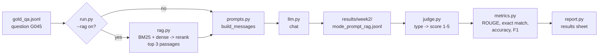

# Walkthrough: how one question flows through the code

This follows a single gold question, **G045**, from the gold set to a row in the results sheet:

> *Can an appeal be filed to the Supreme Court against an order made by the National Commission under its appellate jurisdiction?*
> Gold answer: *No, an appeal to the Supreme Court is not available against an order made by the National Commission in its appellate jurisdiction.*

## 1. Settings: `copilot/config.py`

Every other file reads its settings through `config.get(name)` (`copilot/config.py:48`). It looks in the environment, then `.env`, then `DEFAULTS` (`copilot/config.py:13`). `COPILOT_MODE` chooses `local` (Ollama + a local embedding model) or `api` (the course APIs). Keys come from `config.secret()` and certificates from `config.cert()`, both at runtime, so neither is ever written into code or results.

## 2. The runner: `copilot/run.py`

`python -m copilot.run --mode api --prompt zero --rag on`

- `main()` (`copilot/run.py:28`) loads the 80 gold rows and works out the output file, `results/week2/api_zero_rag.jsonl`.
- `load_done()` (`copilot/run.py:16`) reads what is already in that file. Rows with an answer are skipped. Rows that failed (no answer) are removed, so they get asked again. That is what makes a run resumable.
- For G045 it calls the retriever (step 3), builds the prompt (step 4), sends it (step 5) and appends one JSON row with the answer, the latency, the token counts and the IDs of the retrieved passages.

## 3. Retrieval: `copilot/rag.py`

`rag.load_retriever(mode)` builds a `Retriever` (`copilot/rag.py:117`):

1. `chunk_corpus()` (`copilot/rag.py:88`) splits the `context` of every master-set row into chunks of 500 BERT tokens. Each chunk keeps `qa_id`, the ID of the row it came from. Only the context is indexed. If the questions were indexed too, gold questions would be found by matching their own wording, which is what produced the invalid 100% Recall@3.
2. `build_vector_store()` (`copilot/rag.py:101`) opens Chroma in `chroma_db/<mode>_500/` and embeds only the chunks it doesn't have yet. The first run builds the index; later runs just load it.
3. Four retrievers are set up. **BM25** matches exact words such as "Section 58" (lower-cased, punctuation dropped, by `bm25_words()`). **Dense** matches meaning. **Hybrid** is LangChain's `EnsembleRetriever`, which merges the two lists 50/50. **Rerank** passes the hybrid candidates through the `ms-marco-MiniLM-L-6-v2` cross-encoder, which reads the question and each chunk together and keeps the best 3.

For G045, `retriever.search(question)` (`copilot/rag.py:130`) returned `PR-1410549`, `PR-2080598` and `PR-2338917`. `PR-2080598` is the gold passage.

## 4. The prompt: `copilot/prompts.py`

`build_messages(question, style, passages)` (`copilot/prompts.py:40`) returns the chat messages:

- Always: the Week 1 system prompt, *"You are a helpful Indian consumer rights assistant."*
- `few`: three example question-and-answer pairs come before the question.
- With RAG: the passages are numbered `[1] [2] [3]` under `CONTEXT`, above the question.
- `cot`: the step-by-step instruction is added at the end, asking for a `Final answer:` line.

## 5. The model call: `copilot/llm.py`

- `make_client(mode)` (`copilot/llm.py:17`) returns an OpenAI-format client. Ollama and the course API both speak this format, so only the URL, key and model change. In API mode it also switches off Qwen3's thinking.
- `chat()` (`copilot/llm.py:30`) sends the request with temperature 0, seed 42 and at most 1,024 output tokens. It retries on 429/503 and dropped connections, removes any stray `<think>` block, and returns the answer with usage numbers. If every try fails, it returns `answer=None` and an error.

For G045, gemma3:27b without RAG said *"Yes, but with limitations"* and invented a route through the High Court. With the three passages it answered *"no"* and cited passage [2].

## 6. The judge: `copilot/judge.py`

`python -m copilot.judge results/week2/api_zero_rag.jsonl`

`judge_one()` (`copilot/judge.py:105`) sends gemma3:27b the **question, gold answer and response only**. The question type is **not** sent; the mentor flagged that as leakage. The system prompt (`SYSTEM`, `copilot/judge.py:58`) carries the `GUIDELINES` (`copilot/judge.py:28`): how to recognise each of the five question types, the grading rules for each, and the 1–5 scale. Ollama's `format=SCHEMA` (`copilot/judge.py:79`) forces the reply into JSON with the fields in this order:

`type_rationale` → `question_type` → `answer_rationale` → `score` → `conclusion`, `failure_type`, `refused`, `outdated_limits`

Because the model writes its reasoning before its score, the score follows from the reasoning. `gold_type()` (`copilot/judge.py:96`) converts the gold labels to the same five types, but it is used only to check the judge's answer and is stored next to it in `<run>_judged.jsonl`.

## 7. Metrics: `copilot/metrics.py`

`score_rows()` (`copilot/metrics.py:95`) combines the run, the judgements and the gold set, giving one row per question:

- **ROUGE-1/2/L** against the gold answer, with no LLM involved.
- **Exact match** (`copilot/metrics.py:59`), Math/Logic only: does the answer contain the gold key value? `key_phrase()` (`copilot/metrics.py:47`) picks that value out: the commission name, or the date or amount after "i.e.".
- **Retrieval Miss**: if a RAG answer scored below 5 and none of its retrieved IDs is the gold passage, the failure is a retrieval miss and not the model's fault.

`run_metrics()` (`copilot/metrics.py:133`) then adds up these rows: mean score, strict and lenient accuracy, judge type accuracy, jurisdiction F1, safety F1, failure counts, outdated limits and latency.

## 8. Results sheet: `copilot/report.py`

`python -m copilot.report --mode api` finds every judged `api_*` run and writes `results/week2/results_api.xlsx` and `.md`. The sheets are: Summary (one row per run), By category, Per question (every answer with its score and the judge's rationale), and Definitions. The Markdown version also includes the Recall@3 table from `copilot/recall.py`.

## Where to look when a number is surprising

| Question | Look at |
|---|---|
| Why did this answer get this score? | `answer_rationale` in `<run>_judged.jsonl`, or the Per question sheet |
| Did the judge understand the question? | `question_type` vs `gold_type` in `<run>_judged.jsonl` |
| Was the right passage retrieved? | `retrieved_ids` in the run file vs `gold_context_ids` in the gold set; or `python app.py --id <ID>` |
| Is the retriever the problem? | `results/week2/recall_<mode>.md` (no LLM involved) |
